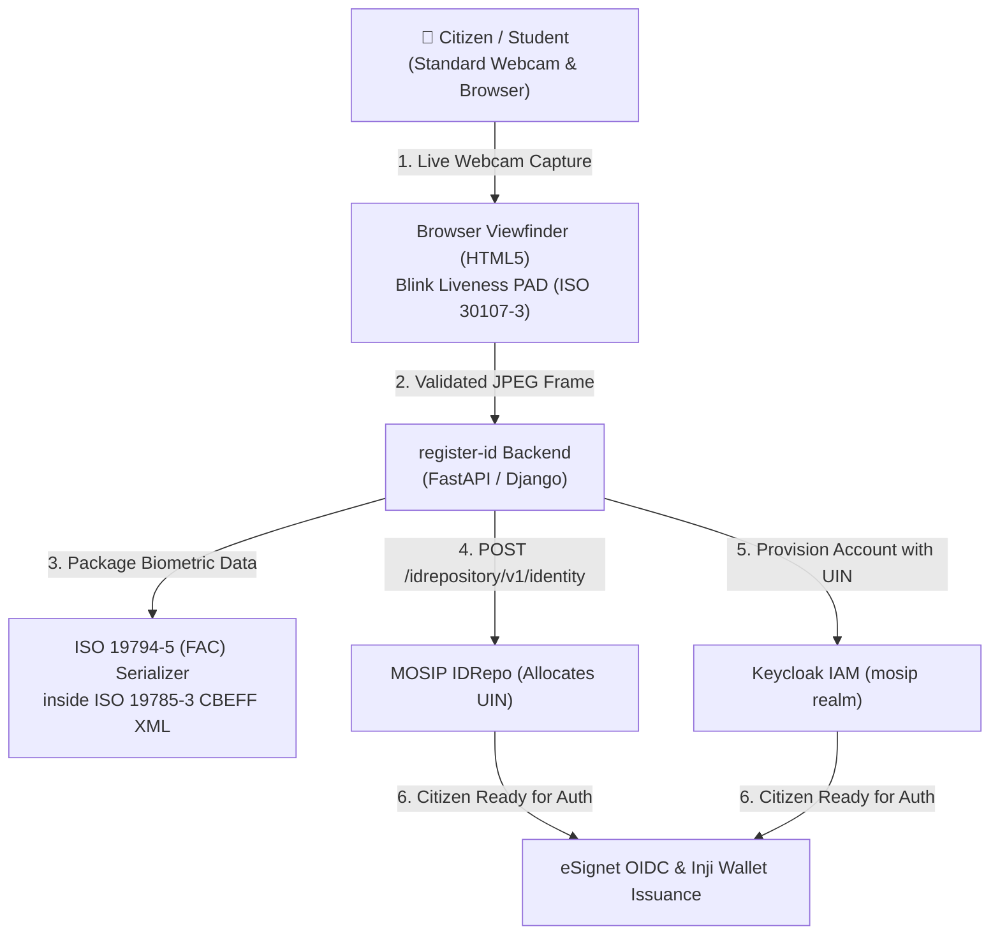

<div align="center">

# 🪪 register-id

**DPI Citizen Registration Gateway & Zero-Hardware Onboarding Portal**  
*Part of the MOSIP Asia Digital Public Infrastructure (DPI) Suite — Agency A: National Identity Authority (`register.id.<domain>`)*

[](https://github.com/mosip-asia/dpi-register-id/actions/workflows/ci.yml)
[](https://github.com/mosip-asia/dpi-register-id/actions/workflows/cd.yml)
[](https://www.python.org/)
[](https://fastapi.tiangolo.com/)
[](https://www.djangoproject.com/)
[](https://docs.celeryq.dev/)
[](https://github.com/astral-sh/uv)
[](https://github.com/mosip-asia/dpi-register-id/pkgs/container/dpi-register-id)
[](LICENSE)

</div>

---

## 📌 Overview & Architectural Context

`register-id` serves as the **Citizen Registration Gateway** (`https://register.id.<domain>`) in the MOSIP Asia Digital Public Infrastructure (DPI) architecture. It enables remote, zero-hardware citizen enrollment directly from standard web browsers.

### The Problem
Upstream MOSIP traditionally requires citizens to enroll in person at physical registration centers using an 800 MB Java desktop application (`mosip/registration-client`) connected to proprietary L0/L1 SBI USB biometric scanners ($500+ each) and processed through 17 batch packet decryption pods (`regproc-*`).

### The Solution: Zero-Hardware Browser Onboarding
`register-id` replaces the desktop registration barrier with a lightweight, browser-based onboarding flow:



### Key Architectural Principles
* **Zero Hardware Barrier:** Works in any modern HTML5/WebRTC-compliant browser without proprietary fingerprint/iris/face capture hardware.
* **ISO 30107-3 Liveness (PAD):** Client-side presentation attack detection (active blink and motion challenge) to reject static photo, video replay, and deepfake injections.
* **ISO 19794-5 CBEFF Format:** Encapsulates facial biometric records in standard ISO/IEC 19794-5 (`FAC\0` binary payload) within an ISO 19785-3 CBEFF XML envelope, ensuring 100% upstream interoperability with MOSIP `id-repository`, `id-authentication` (IDA), and the AI-BioSDK matcher.
* **Direct Substrate Seeding:** Directly interfaces with MOSIP IDRepo (`POST /idrepository/v1/identity`) using internal Keycloak service tokens (`mosip-idrepo-client`), bypassing heavy batch packet pipelines while maintaining exact schema parity.

---

## 🏛️ Mandated Standards & Lifecycle

1. **Branching Model**:
   - **`dev` (Default)**: Daily development and feature branches fork/merge here. Pushes do not auto-deploy.
   - **`stg`**: Staging branch. Promoted via PR from `dev` (`bash scripts/release.sh pr stg`). Merging triggers automated deployment to `staging`.
   - **`main`**: Production branch. Promoted via PR from `stg` (`bash scripts/release.sh pr main`). Merging triggers automated deployment to `production`.
2. **Release & GHCR**: Releases are cut from `dev` using `bash scripts/release.sh vX.Y.Z`. Pushing the tag triggers CI tests and builds/pushes Docker images to GitHub Container Registry (`ghcr.io/mosip-asia/dpi-register-id`).
3. **Configuration**: Strictly one [`.env.example`](.env.example) template. Local setup is `cp .env.example .env`.
4. **Data Hygiene**: Never commit spreadsheets, database dumps, credentials, or raw PII. Enforced locally and in CI via `bash scripts/check-data-guard.sh`.

---

## 🚀 Quick Start

### 1. Setup Environment
```bash
# 1. Create local environment file from template
cp .env.example .env

# 2. Install dependencies with uv
uv sync
```
*(VS Code Dev Containers are also supported via `.devcontainer/`)*.

### 2. Run with Docker Compose (Full Stack)
```bash
# Spin up complete stack (App + Redis + PostgreSQL IDRepo + Keycloak IAM)
docker compose up -d

# Open Web Gateway:    http://localhost:8000
# Open Keycloak Admin:  http://localhost:8080 (admin / admin)
# PostgreSQL IDRepo:    localhost:5432
```

### 3. Run Locally with uv (Hybrid Mode)
```bash
# 1. Start background datastores (Redis, Postgres, Keycloak)
docker compose up -d redis postgres keycloak

# 2. Run Web Server locally
uv run register-id web

# 3. (Optional) Run Background Celery Worker
uv run register-id celery worker
```

### 4. Run Pre-Push Checks
```bash
bash scripts/check.sh
```

---

## 🛠️ Operational Scripts (`scripts/`)

| Script | Purpose | Usage |
|---|---|---|
| **[`check.sh`](scripts/check.sh)** | Pre-push verification (data guard, tests, Django check) | `bash scripts/check.sh` |
| **[`release.sh`](scripts/release.sh)** | Cut release tag, push to origin, build GHCR image | `bash scripts/release.sh v0.1.0` |
| **[`release.sh pr`](scripts/release.sh)** | Open promotion PR to `stg` or `main` | `bash scripts/release.sh pr stg` / `pr main` |
| **[`deploy.sh`](scripts/deploy.sh)** | Deploy stack (Docker Compose or local `uv`) with smoke tests | `bash scripts/deploy.sh dev` |
| **[`smoke-test.sh`](scripts/smoke-test.sh)** | End-to-end post-deployment health & route checks | `bash scripts/smoke-test.sh http://localhost:8000` |
| **[`check-data-guard.sh`](scripts/check-data-guard.sh)** | Verify sensitive data guard and file hygiene | `bash scripts/check-data-guard.sh` |

---

## 📚 Detailed Documentation (`docs/`)

Technical details, architecture specifications, and implementation schedules are organized in [`docs/`](docs/):

### 🏛️ Architecture & Project Operations
- **[Objectives & Weekly Milestones](docs/objectives-and-milestones.md)**: Implementation goals, system architecture, RACI matrix, and 8-week delivery milestones (Weeks 1–8).
- **[CI/CD & Deployment Guide](docs/deployment.md)**: Multi-environment deployment pipeline (`cd.yml`), NetBird VPN mesh, Traefik reverse proxy overlay, and automated rollbacks.
- **[AI Agent Invariants (`AGENTS.md`)](AGENTS.md)**: Operational invariants and architectural guidelines for AI coding assistants.

### 🎓 Starter Foundation Tutorials (`docs/tutorial/`)
- **[FastAPI & Web Service](docs/tutorial/fastapi-web.md)**: REST endpoints, Jinja2 templates, `/health` check, and routing.
- **[Celery & Background Tasks](docs/tutorial/celery-processor.md)**: Asynchronous task queuing, Redis configuration, and process supervision.
- **[Django Modular Apps](docs/tutorial/django.md)**: Reusable app architecture, `django_manage.py`, migrations, and settings.

---

## 📁 Project Structure

```
.
├── .devcontainer/               # VS Code Dev Container configuration
├── .github/                     # GitHub Actions CI/CD workflows and composite actions
├── data/                        # Local data directory (ignored by git)
├── docs/                        # Architecture, roadmap & deployment documentation
│   ├── objectives-and-milestones.md # Core specification & 8-week delivery plan
│   ├── deployment.md            # CD pipeline, NetBird VPN, Traefik ingress
│   └── tutorial/                # Foundation tutorials (FastAPI, Celery, Django)
├── logs/                        # Application logs (ignored by git)
├── models/                      # Model checkpoints and weights (ignored by git)
├── notebooks/                   # Jupyter notebooks (0-starter.ipynb)
├── scripts/                     # Automation, release, and deployment scripts
├── src/
│   ├── project/                 # Core application package
│   │   ├── register_id/         # Citizen Registration Gateway (Liveness, Matcher, CBEFF, IDRepo)
│   │   ├── web/                 # FastAPI routes, templates, WebRTC viewfinder
│   │   ├── processor/           # Processor module (demo/tutorial)
│   │   └── processor_celery/    # Async background task processors (demo/tutorial)
│   ├── django_core/             # Django dev harness and routing
│   └── django_module/           # Reusable Django module example
├── .env.example                 # Single environment configuration template
├── AGENTS.md                    # Operational guidelines for AI agents
├── django_manage.py             # Django entrypoint script
├── docker-compose.yml           # Base compose stack (App + Redis)
├── docker-compose.mosip.yml     # MOSIP local overlay (PostgreSQL IDRepo + Keycloak IAM)
├── docker-compose.traefik.yml   # Traefik overlay for deployed environments
├── Dockerfile                   # Multi-stage production container build
├── pyproject.toml               # Project dependencies and packaging (register-id)
└── README.md
```

---

## 📄 License

This project is licensed under the MIT License - see the [LICENSE](LICENSE) file for details.
