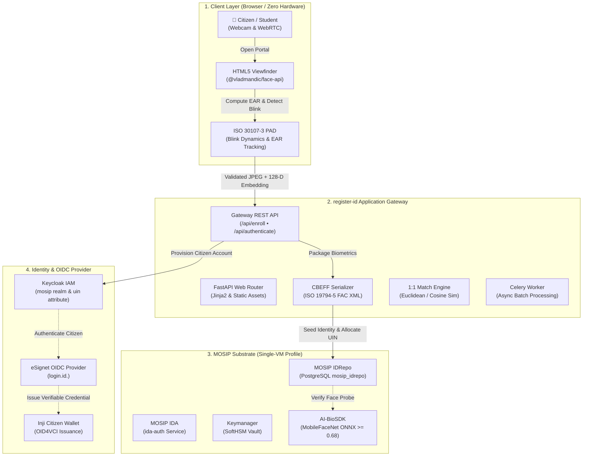

# 🎯 Objectives, Architecture Scope & Weekly Milestones

> **Project:** `register-id` (DPI Citizen Registration Gateway)  
> **Suite:** MOSIP Asia Digital Public Infrastructure (DPI) — Agency A: National Identity Authority (`*.id.<domain>`)  
> **Grant Context:** Activity 1.5 under the Bill & Melinda Gates Foundation Ecosystem Grant  
> **Key Partners:** AIT Development Team, Mehul (`@thassung`, Track 1 & 2 Infra), Sila (`@silanm`)  
> **Target Release:** Milestone 1.5.3 (Code Freeze: 31 Dec 2026) & Milestone 1.5.4 (Audit & Final Delivery: 30 Jan 2027)

---

## 1. Executive Summary & Problem Statement

### 1.1 The Upstream MOSIP Registration Barrier
In sovereign deployments, the Modular Open Source Identity Platform (MOSIP) mandates physical, in-person citizen registration:
* **Heavy Desktop Client:** Citizens and operators must install an 800 MB Java desktop application (`mosip/registration-client`).
* **Proprietary Hardware:** Enrollment requires vendor-locked, certified L0/L1 Secure Biometric Interface (SBI) scanners costing $500+ per device.
* **Complex Backend Infrastructure:** Biometric packets are encrypted and processed through a 17-pod batch decryption pipeline (`regproc-*`), consuming over 35 GB of RAM.

### 1.2 The `register-id` Solution
`register-id` eliminates the hardware and desktop client barriers by providing a **zero-hardware, browser-based citizen onboarding portal** (`https://register.id.<domain>`):
1. **Zero Hardware Requirement:** Any citizen or student can enroll using a standard HTML5 WebRTC browser webcam on a desktop, laptop, or mobile phone.
2. **ISO/IEC 30107-3 Liveness (PAD):** Client-side presentation attack detection evaluates real-time Eye Aspect Ratio (EAR) and natural eye blinks to reject printed photos, video replays, and deepfakes.
3. **ISO 19794-5 & ISO 19785-3 CBEFF Serialization:** Packages webcam frames into standard ISO/IEC 19794-5 binary payloads (`FAC\0`) enveloped in ISO 19785-3 CBEFF XML, maintaining 100% data compatibility with MOSIP IDRepo and downstream AI-BioSDK matchers.
4. **Direct Substrate Seeding:** Integrates directly with MOSIP IDRepo (`POST /idrepository/v1/identity`) and Keycloak IAM (`mosip` realm) to allocate a Unique Identification Number (UIN) and provision user credentials for eSignet OIDC login within seconds.

---

## 2. System Architecture & Component Interactions



---

## 3. Core Implementation Objectives

| # | Objective | Description | Technical Acceptance Criteria |
|---|---|---|---|
| **OBJ-1** | **Zero-Hardware Web Onboarding** | Provide a frictionless browser interface for student and citizen face capture. | Works on standard Chrome/Safari/Edge browsers; supports live WebRTC stream and high-res image upload fallback. |
| **OBJ-2** | **ISO 30107-3 Liveness PAD** | Enforce anti-spoofing to reject 2D printouts and replay attacks. | Tracks 68 facial landmarks; computes Eye Aspect Ratio ($EAR < 0.23, \Delta \ge 0.06$); requires $\ge 1$ natural blink. |
| **OBJ-3** | **CBEFF ISO 19794-5 Serialization** | Format captured face biometrics into standard MOSIP format. | Generates valid ISO 19794-5 `FAC\0` binary payloads wrapped in ISO 19785-3 CBEFF XML headers. |
| **OBJ-4** | **MOSIP IDRepo Seeding** | Direct persistence into master citizen identity database. | Seeds `mosip_idrepo.citizen_identity` and interfaces with IDRepo REST endpoints (`POST /idrepository/v1/identity`). |
| **OBJ-5** | **Keycloak IAM Integration** | Synchronize citizen accounts for eSignet OIDC login. | Automates Keycloak Admin API token exchange; creates user in `mosip` realm with `uin` attribute and password. |
| **OBJ-6** | **AI-BioSDK Interoperability** | Verify enrolled gallery against live webcam probes. | End-to-end 1:1 biometric authentication succeeds against `ai-biosdk-service` with Cosine Similarity $\ge 0.68$. |
| **OBJ-7** | **CI/CD & Operational Symmetry** | Ensure staging/production alignment with automated rollbacks. | Passes `scripts/check.sh` (data guard, tests, django check); deploys via GitHub Actions (`cd.yml`). |

---

## 4. Weekly Milestone Roadmap

The implementation is structured into an **8-week execution plan** starting mid-November 2026, targeting code freeze by **31 December 2026 (Milestone 1.5.3)** and production validation by **30 January 2027 (Milestone 1.5.4)**.

```mermaid
gantt
    title register-id Weekly Delivery Schedule
    dateFormat  YYYY-MM-DD
    section Phase 1: Foundation
    W1: Repo Setup & POC Porting         :done,    w1, 2026-11-11, 2026-11-17
    W2: WebRTC Viewfinder & Client PAD   :active,  w2, 2026-11-18, 2026-11-24
    section Phase 2: Biometrics & Standards
    W3: CBEFF & ISO 19794-5 Serialization:         w3, 2026-11-25, 2026-12-01
    W4: IDRepo Seeding & Keycloak Bridge :         w4, 2026-12-02, 2026-12-08
    section Phase 3: Integration & Hardening
    W5: AI-BioSDK 1:1 Matching Loop      :         w5, 2026-12-09, 2026-12-15
    W6: Security, Nonce & Audit Logging  :         w6, 2026-12-16, 2026-12-22
    section Phase 4: Release & Deployment
    W7: Staging Rollout & Code Freeze    :         w7, 2026-12-23, 2026-12-31
    W8: Production Verification & Audit  :         w8, 2027-01-01, 2027-01-30
```

---

### Week 1 (11 Nov – 17 Nov 2026): Repository Standardization & Modular Core
* **Focus:** Standardizing the cloned repository template and porting the Day-1 POC into a clean modular Python architecture.
* **Deliverables:**
  - [x] Configure repository metadata, package name (`register-id`), and Typer CLI entrypoints in [`pyproject.toml`](../pyproject.toml).
  - [x] Integrate PostgreSQL (`psycopg2-binary`) and HTTP (`requests`) dependencies with `uv`.
  - [x] Define environment variables for IDRepo and Keycloak in [`.env.example`](../.env.example).
  - [x] Modularize core processor logic into `src/project/processor/` (`liveness.py`, `matcher.py`, `idrepo.py`, `keycloak.py`).
  - [x] Verify baseline test suite passing: `bash scripts/check.sh`.
* **Exit Criteria:** Clean repo structure; green CI; CLI runs `uv run register-id --help`.

---

### Week 2 (18 Nov – 24 Nov 2026): WebRTC Viewfinder & Client-Side PAD
* **Focus:** Developing the browser-based registration UI with real-time biometric and liveness feedback.
* **Deliverables:**
  - [ ] Port HTML5/WebRTC camera viewfinder into [`src/project/web/templates/index.html`](../src/project/web/templates/index.html) with responsive Tailwind CSS.
  - [ ] Load `@vladmandic/face-api` (SSD MobileNet V1, 68 facial landmarks, 128-D descriptor extraction).
  - [ ] Implement client-side Eye Aspect Ratio (EAR) calculation and dynamic blink counter.
  - [ ] Add photo file upload fallback for devices without webcam permissions.
  - [ ] Implement random challenge prompt (e.g. "Blink 2 times within 5 seconds") to combat replay attacks.
* **Exit Criteria:** Users can open `http://localhost:8000`, see their camera stream, perform a natural blink, and observe real-time PAD validation.

---

### Week 3 (25 Nov – 01 Dec 2026): CBEFF XML & ISO 19794-5 Serialization
* **Focus:** Transforming webcam frames into standardized biometric envelopes acceptable by MOSIP IDRepo and IDA.
* **Deliverables:**
  - [ ] Implement ISO/IEC 19794-5 face record packaging (`src/project/processor/cbeff.py`):
    * Binary record header with `FAC\0` format identifier and version `010`.
    * Facial feature points (eye center, nose tip) and boundary dimensions.
    * Base64-encoded compressed JPEG payload.
  - [ ] Construct ISO 19785-3 Common Biometric Exchange Formats Framework (CBEFF) XML structure:
    * `<BIR>` root envelope with `<Version>` and `<CBEFFVersion>`.
    * `<BDBInfo>` metadata: format owner `257` (MOSIP), format type `8` (Face).
    * `<BDB>` container holding the base64-encoded ISO 19794-5 record.
  - [ ] Write comprehensive unit tests validating CBEFF XML parsing and schema compliance.
* **Exit Criteria:** Serialized biometric XML validates successfully against MOSIP's CBEFF XSD schema.

---

### Week 4 (02 Dec – 08 Dec 2026): MOSIP IDRepo & Keycloak IAM Integration
* **Focus:** Connecting the gateway backend to the identity storage and IAM services.
* **Deliverables:**
  - [ ] Implement direct PostgreSQL client in `src/project/processor/idrepo.py` supporting `mosip_idrepo.citizen_identity`.
  - [ ] Implement REST client for upstream MOSIP IDRepo `POST /idrepository/v1/identity` using service tokens (`mosip-idrepo-client`).
  - [ ] Implement Keycloak IAM bridge in `src/project/processor/keycloak.py`:
    * Admin token acquisition via `client_id: admin-cli`.
    * User account creation in `mosip` realm with `uin`, name, email, and password.
    * Attribution of `individualBiometrics: VALID` claim.
  - [ ] Add local Docker Compose mock services for Keycloak and Postgres to facilitate offline testing.
* **Exit Criteria:** A completed enrollment form creates a verified record in Postgres and an active user in Keycloak.

---

### Week 5 (09 Dec – 15 Dec 2026): AI-BioSDK Matcher & 1:1 Authentication Loop
* **Focus:** Validating the biometric matching pipeline using the lightweight deep-learning REST container.
* **Deliverables:**
  - [ ] Connect `register-id` with `mosip-asia/ai-biosdk-service` (MobileFaceNet ONNX).
  - [ ] Implement 1:1 authentication test tab in `register-id` UI:
    * Select enrolled citizen UIN.
    * Capture live webcam probe with active blink PAD.
    * Forward stored gallery + live probe to BioSDK matcher (`POST /match`).
    * Evaluate Cosine Similarity ($\ge 0.68$) and display confidence score.
  - [ ] Add latency profiling to ensure end-to-end matching completes in $< 250\text{ ms}$.
* **Exit Criteria:** Enrolled citizen face successfully authenticates against stored biometric gallery with $\ge 90\%$ match confidence.

---

### Week 6 (16 Dec – 22 Dec 2026): Security Hardening, Ephemeral Nonces & Data Guard
* **Focus:** Hardening the service for public internet deployment behind Traefik.
* **Deliverables:**
  - [ ] Implement single-use ephemeral nonce (60-second TTL) to guarantee anti-replay security for biometric packets.
  - [ ] Enforce HTTPS termination and Content Security Policy (CSP) for WebRTC permissions.
  - [ ] Enforce data hygiene: verify that raw citizen face images are never written to disk or committed to Git (`scripts/check-data-guard.sh`).
  - [ ] Implement Celery worker tasks for asynchronous background auditing and cleanup (`src/project/processor_celery/`).
  - [ ] Achieve $> 85\%$ test coverage across all processor modules.
* **Exit Criteria:** Penetration and replay resistance checks pass; data guard cleanly verifies zero PII leaks.

---

### Week 7 (23 Dec – 31 Dec 2026): Staging Deployment & Milestone 1.5.3 Code Freeze
* **Focus:** Promoting code to Staging environment and freezing core functionality.
* **Deliverables:**
  - [ ] Tag release `v0.2.0` from `dev` and push to build GHCR container image (`ghcr.io/mosip-asia/dpi-register-id`).
  - [ ] Open promotion PR to `stg` branch (`bash scripts/release.sh pr stg`).
  - [ ] Validate automated CD workflow (`.github/workflows/cd.yml`) deploying to Staging environment via NetBird VPN mesh.
  - [ ] Execute automated post-deployment smoke tests (`scripts/smoke-test.sh https://register.id.stg.ait.ac.th`).
  - [ ] Finalize Milestone 1.5.3 code freeze.
* **Exit Criteria:** Working Staging deployment accessible over public HTTPS with automated smoke test approval.

---

### Week 8 (01 Jan – 30 Jan 2027): Production Hardening & Milestone 1.5.4 Delivery
* **Focus:** Multi-tenant stress testing, documentation sign-off, and final ecosystem integration.
* **Deliverables:**
  - [ ] End-to-end integration test with Inji Wallet and DOPA Verifiable Credential Issuer (`https://issuer.id.<domain>`).
  - [ ] Concurrency testing: verify gateway handles 50 concurrent WebRTC enrollment sessions without memory leaks.
  - [ ] Open promotion PR from `stg` to `main` (`bash scripts/release.sh pr main`) for Production deployment.
  - [ ] Final security audit and compliance verification for Activity 1.5 grant milestone.
* **Exit Criteria:** Production deployment live on `https://register.id.<domain>`; grant milestone accepted.

---

## 5. Team RACI Matrix & Responsibilities

| Workstream / Deliverable | AIT Dev Team (Lead) | AIT BioSDK Lead | Mehul (`@thassung`) | Sila (`@silanm`) |
|---|:---:|:---:|:---:|:---:|
| **WebRTC Viewfinder & UI** | **Accountable / Responsible** | Consulted | Informed | Consulted |
| **ISO 30107-3 Liveness (PAD)** | **Accountable / Responsible** | Consulted | Informed | Informed |
| **CBEFF XML Serialization** | **Responsible** | **Accountable** | Consulted | Consulted |
| **IDRepo & Keycloak Integration** | **Accountable / Responsible** | Informed | Consulted | Consulted |
| **AI-BioSDK Matcher Service** | Consulted | **Accountable / Responsible** | Consulted | Informed |
| **K8s & Single-VM Infra (`sizes/hackathon.tfvars`)** | Informed | Informed | **Accountable / Responsible** | Consulted |
| **CI/CD & Deployment Workflows** | **Responsible** | Informed | Consulted | **Accountable** |
| **Milestone Review & Grant Acceptance** | Consulted | Consulted | Consulted | **Accountable** |

---

## 6. Definition of Done (DoD) Checklist

For any feature or milestone to be considered **Done**:
- [ ] Code is authored on a feature branch branched off `dev` and passes all local checks (`bash scripts/check.sh`).
- [ ] Automated unit and integration tests are committed with $> 80\%$ test coverage.
- [ ] No secrets, PII, test images, or credentials exist in git history (`bash scripts/check-data-guard.sh`).
- [ ] Pull request reviewed and approved before merging into `dev`.
- [ ] Environment variables and schema changes documented in [`.env.example`](../.env.example).
- [ ] Smoke tests succeed against the target URL (`bash scripts/smoke-test.sh`).
